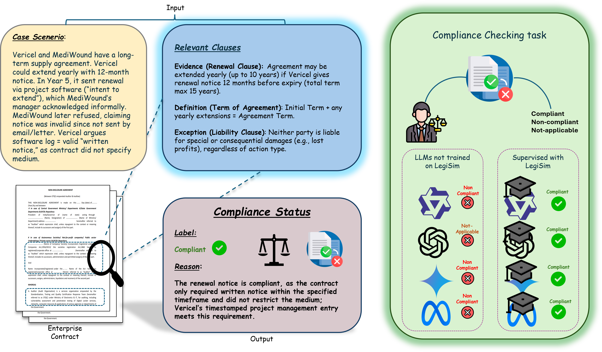
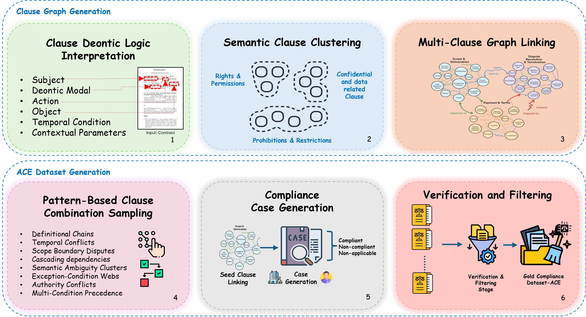

# ACE: Assessing Compliance in Enterprise

<p align="center">
  <a href="https://arxiv.org/abs/XXXX.XXXXX"></a>
  
  
  
</p>

<p align="center">
  <b>A benchmark for multi-clause contract compliance reasoning</b><br/>
  <i>Accepted at EACL 2026 Main Conference</i>
</p>

---

## 🚀 Quick Start

```bash
git clone https://github.com/FujitsuResearch/Fujitsu-Assessing-Compliance-in-Enterprise-Dataset.git
cd Fujitsu-Assessing-Compliance-in-Enterprise-Dataset
````

```python
import json

with open("train.json") as f:
    train_data = json.load(f)

print(f"Train samples: {len(train_data)}")
print(train_data[0].keys())
```

---

## 📌 Overview

**ACE (Assessing Compliance in Enterprise)** is a benchmark for evaluating **multi-clause compliance reasoning over real-world contracts**.

It contains **4,700 compliance scenarios** derived from **633 enterprise contracts** across **26 agreement types**. Each example requires reasoning over **multiple interacting clauses**—including obligations, exceptions, and temporal conditions—to determine whether a scenario is:

* ✅ Compliant
* ❌ Non-Compliant
* ⚖️ Not-Applicable

Unlike prior benchmarks that focus on **single-clause reasoning**, ACE targets the realistic setting where **cross-clause dependencies** determine compliance.

---

## 🧠 Task Definition

> **Input:**
>
> * A natural language **scenario**
> * A set of **relevant contract clauses**
>
> **Output:**
>
> * One label: `Compliant`, `Non-Compliant`, or `Not-Applicable`

<p align="center">
  
  <br/>
  <i>Figure 1: ACE task formulation</i>
</p>

---

## 🔍 Why ACE is Different

| Benchmark   | Task                      | Reasoning Scope            |
| ----------- | ------------------------- | -------------------------- |
| CUAD        | Clause extraction         | Single clause              |
| ContractNLI | Entailment                | Mostly local evidence      |
| **ACE**     | Compliance classification | **Multi-clause reasoning** |

ACE requires models to:

* Combine multiple clauses
* Resolve exceptions and dependencies
* Handle temporal and conditional logic
* Avoid surface-level shortcuts

---

## 📦 Dataset Statistics

### Corpus

| Property            | Value              |
| ------------------- | ------------------ |
| Total Scenarios     | 4,700              |
| Source Contracts    | 633                |
| Agreement Types     | 26                 |
| Scenario Uniqueness | 95.3%              |
| Source Corpora      | CUAD + ContractNLI |

### Split Distribution

| Split     | Total     | Compliant | Non-Compliant | Not-Applicable |
| --------- | --------- | --------- | ------------- | -------------- |
| Train     | 3,600     | 1,200     | 1,200         | 1,200          |
| Test      | 1,100     | 380       | 400           | 320            |
| **Total** | **4,700** | **1,580** | **1,600**     | **1,520**      |

> Note: The training split includes all released training data. No separate validation split is provided.

---

## 📁 Repository Structure

```
Fujitsu-Assessing-Compliance-in-Enterprise-Dataset/
├── README.md
├── train.json
├── test.json
└── assets/
    ├── figure1.png
    └── figure2.png
```

---

## 📊 Dataset Format

### `train.json`

Each training example includes:

* Clauses
* Scenario
* Ground-truth label
* Teacher reasoning trace

```json
{
  "clauses": {"evidence_1": "..."},
  "scenario_text": "...",
  "gd_tr": "Compliant",
  "DeepSeek_reasoning_trace": "...",
  "DeepSeek_prediction": "Compliant"
}
```

### `test.json`

Test examples contain:

* Clauses
* Scenario
* Ground-truth label

(No reasoning traces provided)

```json
{
  "clauses": {"evidence_1": "..."},
  "scenario_text": "...",
  "gd_tr": "Compliant"
}
```

---

## 🏷️ Label Definitions

| Label              | Meaning                                   |
| ------------------ | ----------------------------------------- |
| **Compliant**      | Scenario adheres to the governing clauses |
| **Non-Compliant**  | Scenario violates the clauses             |
| **Not-Applicable** | Clauses do not govern the scenario        |

---

## 🛠️ Usage

### Load Data

```python
import json

train = json.load(open("train.json"))
test = json.load(open("test.json"))
```

### Example

```python
sample = train[0]
print(sample["scenario_text"])
print(sample["gd_tr"])
```

---

## 📈 Evaluation

```python
from sklearn.metrics import accuracy_score, f1_score

y_true = [x["gd_tr"] for x in test]
y_pred = [...]  # your model predictions

acc = accuracy_score(y_true, y_pred)
f1  = f1_score(y_true, y_pred, average="macro")

print(acc, f1)
```

**Note:**

* Use **macro-F1** for balanced evaluation
* Predictions must be one of:

  * `Compliant`
  * `Non-Compliant`
  * `Not-Applicable`

---

## ⚙️ COMPACT Framework

ACE is generated using the **COMPACT pipeline**, which:

1. Extracts deontic-temporal entities
2. Clusters semantically related clauses
3. Builds clause graphs
4. Samples complex clause interactions
5. Generates adversarial scenarios
6. Validates quality via LLM-based filtering

<p align="center">
  
  <br/>
  <i>Figure 2: COMPACT pipeline for ACE construction</i>
</p>

---

## ✅ Dataset Quality

ACE is validated across multiple dimensions:

| Metric                        | Score | Insight                       |
| ----------------------------- | ----- | ----------------------------- |
| Synthetic Detectability       | 18.8% | Hard to distinguish from real |
| Interpretability (no clauses given) | 38.6% | Requires clause reasoning     |
| Ability to Distinguish ACE from Real HIPAA Cases              | 57.1% | Close to real-world cases     |

Human evaluation:

* **96% clause correctness**
* **92% label accuracy**

---

## 🌍 Generalization

Models trained on ACE show improvements on:

* ContractNLI (legal entailment)
* PrivaCI-Bench (HIPAA, EU AI Act)

This suggests ACE teaches **transferable legal reasoning**, not just dataset-specific patterns.

---

## 🎯 Intended Use

ACE is designed for:

* Legal reasoning research
* Benchmark evaluation
* Model fine-tuning

**Not intended for:**

* Legal advice
* Production contract review without human oversight

---

## 📜 License

Released under **CC BY 4.0**.

Source data originates from:

* CUAD
* ContractNLI

Users must comply with their respective licenses.

---

## 📚 Citation

```bibtex
@inproceedings{singh-etal-2026-compact,
    title = "{COMPACT}: Building Compliance Paralegals via Clause Graph Reasoning over Contracts",
    author = "Singh, Ayush  and
      Aggarwal, Dishank  and
      Bhagat, Pranav  and
      Khan, Ainulla  and
      Malik, Sameer  and
      Azad, Amar Prakash",
    editor = "Demberg, Vera  and
      Inui, Kentaro  and
      Marquez, Llu{\'i}s",
    booktitle = "Proceedings of the 19th Conference of the {E}uropean Chapter of the {A}ssociation for {C}omputational {L}inguistics (Volume 1: Long Papers)",
    month = mar,
    year = "2026",
    address = "Rabat, Morocco",
    publisher = "Association for Computational Linguistics",
    url = "https://aclanthology.org/2026.eacl-long.377/",
    doi = "10.18653/v1/2026.eacl-long.377",
    pages = "8081--8112",
    ISBN = "979-8-89176-380-7",
    abstract = "Contract compliance verification requires reasoning about cross-clause dependencies where obligations, exceptions, and conditions interact across multiple provisions, yet existing legal NLP benchmarks like ContractNLI and CUAD focus exclusively on isolated single-clause tasks. We introduce COMPACT (COMpliance PAralegals via Clause graph reasoning over conTracts), a framework that models cross-clause dependencies through structured clause graphs. Our approach extracts deontic-temporal entities from clauses and constructs typed relationship graphs capturing definitional dependencies, exception hierarchies, and temporal sequences. From these graphs, we introduce ACE (Assessing Compliance in Enterprise)- a benchmark containing 4,700 carefully constructed compliance scenarios derived from 633 real-world contracts covering 26 types of agreements. Each scenario requires multi-hop reasoning across multiple clauses, and undergoes independent LLM-based validation to ensure quality. Evaluation reveals that multi-clause reasoning poses a fundamental challenge for state-of-the-art models (34-57{\%} base accuracy), while training on ACE yields substantial improvements on compliance tasks (+22{--}43 {\%} points) and also enhances general legal reasoning performance on other benchmarks (PrivaCI-Bench, ContractNLI)."
}
```

---

## 📬 Contact

For questions or issues, open a GitHub issue or contact:

`{ayush.singh, dishank.aggarwal, pranav.bhagat, ainulla.khan, sameer.malik, amar.azad}@fujitsu.com`
